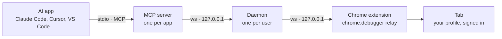

# Browser MCP

**Your own Chrome, driven by AI apps.** Claude Code, Cursor, VS Code, Codex and Claude Desktop use your signed-in sites, your profile and real tabs — while everything stays on your computer.

[**Website**](https://browsermcp.io) · [**Docs**](https://browsermcp.io/docs) · [**Extension**](https://chromewebstore.google.com/detail/bjfgambnhccakkhmkepdoekmckoijdlc) · [**npm**](https://www.npmjs.com/package/@browsermcp/mcp) · [**Apache-2.0**](LICENSE)

> **Local by design.** The MCP server and daemon listen on `127.0.0.1` only. The extension talks to no one else, requires your **Allow** once per computer, and keeps its own rules whatever the daemon asks.

## Contents

- [Why Browser MCP](#why-browser-mcp)
- [How it works](#how-it-works)
- [Two engines](#two-engines)
- [Quick start](#quick-start)
- [The `browser` tool](#the-browser-tool)
- [Several browsers and tabs](#several-browsers-and-tabs)
- [Pairing, permissions and safety](#pairing-permissions-and-safety)
- [Native Go engine (optional)](#native-go-engine-optional)
- [Project layout](#project-layout)
- [Development](#development)
- [Troubleshooting](#troubleshooting)
- [FAQ](#faq)
- [Contributing and security](#contributing-and-security)
- [License](#license)

## Why Browser MCP

|                                 |                                                                                                                                                |
| ------------------------------- | ---------------------------------------------------------------------------------------------------------------------------------------------- |
| **Your session, not a sandbox** | The agent works in your profile: signed-in sites, cookies, extensions, the tabs you already have.                                              |
| **Real Chrome**                 | Chromium browsers with the `debugger` API: Chrome, Edge, Brave, Arc. No bundled browser, no separate profile.                                  |
| **One small tool**              | A single `browser` tool takes many command lines in one call, so an agent can plan a whole workflow instead of one round trip per click.       |
| **Tabs of their own**           | Agents open background tabs in a group named after the app, colored per app, with a toolbar badge showing who is acting. Your tabs stay yours. |
| **Local and permissioned**      | Loopback only, six-digit pairing, **Stop**/Resume, no incognito unless you allow it, no browser or extension pages.                            |
| **Two engines**                 | Node + Playwright by default; an opt-in native Go engine with no Node or Playwright at runtime. Same protocol, same commands.                  |

## How it works



| Process                          | Lifetime                                                 | Job                                                                                                                                         |
| -------------------------------- | -------------------------------------------------------- | ------------------------------------------------------------------------------------------------------------------------------------------- |
| **MCP server** (`dist/index.js`) | one per AI app                                           | Speaks MCP over stdio, starts or replaces the daemon, forwards `tools/list` and `tools/call`, and reads or writes files where the app runs. |
| **Daemon**                       | one per user, exits 10 minutes after the last app leaves | Owns the loopback port, sessions, browser slots, pairing and the command engine.                                                            |
| **Extension**                    | your browser                                             | Relays `chrome.debugger`, enforces the tab rules, pairs with the daemon, shows the popup and badge.                                         |

Ports: the daemon takes the first free of `9010`, `9011`, `9012` (or `--port <n>`, set the same in the extension's settings). State lives in `~/.browsermcp/` (0700): `daemon.json`, `identity.json`, `daemon.log`.

## Two engines

| Mode              | Daemon and engine                             | Enable                                              |
| ----------------- | --------------------------------------------- | --------------------------------------------------- |
| **Default**       | Node daemon, TypeScript + Playwright          | nothing                                             |
| **Go front door** | Go daemon, proxying to the Node engine worker | `BROWSER_MCP_DAEMON=go`                             |
| **Native Go**     | Go daemon and Go browser engine               | `BROWSER_MCP_DAEMON=go` `BROWSER_MCP_ENGINE=native` |

The native engine speaks the same extension protocol and pairing, exposes the same `browser` tool, and passes the repository's real-extension smoke test **20/20**.

| Median of 5 runs, same machine  | Node + Playwright |    Native Go |
| ------------------------------- | ----------------: | -----------: |
| Cold start to `/status`         |           92.4 ms |  **15.0 ms** |
| RSS while a client is connected |           83.5 MB |  **17.4 MB** |
| `click` p50                     |          568.9 ms | **217.1 ms** |
| `fill` p50                      |          276.9 ms |  **10.0 ms** |
| First browser call              |          504.5 ms | **175.1 ms** |
| Large-page `snapshot` p50       |       **50.3 ms** |     213.2 ms |

It is **not the default yet**: large-page snapshots are slower than Playwright's, and raw `cdp` sessions and cross-origin `frameLocator` differ. Details: [compatibility matrix](docs/migration/COMPATIBILITY_MATRIX.md), [measurements](docs/benchmarks/RESULTS.md), [architecture](docs/architecture/ARCHITECTURE.md).

## Quick start

### From npm (fastest)

1. Install the [Browser MCP extension](https://chromewebstore.google.com/detail/bjfgambnhccakkhmkepdoekmckoijdlc) and pin it to the toolbar.
2. Add the server to your AI app and restart it:

   ```sh
   # Claude Code
   claude mcp add --scope user browsermcp -- npx @browsermcp/mcp@latest
   ```

   ```json
   // Most other apps (Cursor, Claude Desktop…)
   {
     "mcpServers": {
       "browsermcp": {
         "command": "npx",
         "args": ["@browsermcp/mcp@latest"]
       }
     }
   }
   ```

3. Ask the agent to open a page. The first time, it tells you to click **Allow** in the extension's popup: check that the popup's six-digit code matches the one the agent shows.

### From source

You need Node.js 24+, pnpm (`corepack enable`) and a Chromium browser. Firefox has no `debugger` API, so Browser MCP doesn't work there. The native Go engine additionally needs Go 1.24+.

```sh
git clone https://github.com/NTbankey1/browser-mcp.git browsermcp
cd browsermcp
pnpm install
pnpm build
```

1. Open `chrome://extensions`, turn on **Developer mode**, click **Load unpacked**, and pick `apps/extension/.output/chrome-mv3`. It is called **"Browser MCP (self-built)"**.
2. Run the server you built in your AI app:

   ```json
   {
     "mcpServers": {
       "browsermcp": {
         "command": "node",
         "args": ["/path/to/browsermcp/packages/mcp/dist/index.js"]
       }
     }
   }
   ```

3. Restart the AI app and click **Allow** when the popup asks, matching the code.

> **Two Browser MCPs in one profile?** Turn off the Chrome Web Store extension if you load the self-built one: both would connect as two browsers. Other profiles may run either build; agents can use tabs in each.

Every build of this extension has the same ID (`imlplcjlhgpajopdbpbngiadkcmdbgob`, from the `key` in `apps/extension/extension-key.ts`), which the server accepts besides the Chrome Web Store's. A build with another key needs its ID in `BROWSER_MCP_EXTENSION_IDS` (comma-separated) or on a line of `~/.browsermcp/dev-extension-ids`.

## The `browser` tool

One tool, one `commands` string, **one command per line**. The agent can put a whole workflow in a single call:

```text
goto https://shop.example.com
fill getByLabel('Email') "me@example.com"
fill getByLabel('Password') "correct horse battery staple"
click getByRole('button', { name: 'Sign in' })
wait --text "Welcome"
snapshot -i
```

The engine parses every line first (a typo runs none of it), then runs them in order, stopping at the first error. Actions print one `✓` line; reads print their output below it. A failed step names the line and what to do next, and the response ends with a `Page:` line when the page changed.

### Actions

| Command                                                                                     | What it does                                                                                                                                    |
| ------------------------------------------------------------------------------------------- | ----------------------------------------------------------------------------------------------------------------------------------------------- |
| `goto <url>`                                                                                | Opens a URL in the agent's tab, creating one on the first call.                                                                                 |
| `back` · `forward` · `reload`                                                               | History and reload, waiting for the page.                                                                                                       |
| `click <target>`                                                                            | Scrolls into view, checks it is visible, enabled and uncovered, then clicks. `--double`, `--button right\|middle`, `--modifiers Shift,Control`. |
| `fill <target> "<text>"`                                                                    | Replaces a field's value at once. `--submit` presses Enter.                                                                                     |
| `type "<text>"`                                                                             | Types key by key into the focused field (autocomplete, search-as-you-type). `--slowly`, `--paste`, `--submit`.                                  |
| `press <key>`                                                                               | `Enter`, `Tab`, `Escape`, `ArrowDown`, `Control+a`, `Meta+Shift+K`…                                                                             |
| `select <target> "<value>"…`                                                                | Selects options by value or label.                                                                                                              |
| `check <target>` · `uncheck <target>`                                                       | Checkboxes, radios and switches.                                                                                                                |
| `hover <target>` · `drag <source> <target>`                                                 | Pointer movement.                                                                                                                               |
| `scroll down\|up [<px>]` · `scroll top\|bottom` · `scroll <target>`                         | Page or scroll-area scrolling; `--in <target>` targets a container.                                                                             |
| `wait <ms>` · `wait --text "…"` · `wait --gone "…"` · `wait --url <glob>` · `wait <target>` | Event-driven waiting instead of fixed sleeps.                                                                                                   |
| `upload <target> <path>…`                                                                   | Sets files on a file input.                                                                                                                     |
| `download <url>\|<target>`                                                                  | Fetches a file as the page would (its cookies, CORS applies).                                                                                   |
| `dialog accept ["<text>"]` · `dialog dismiss`                                               | Answers alert, confirm, prompt and beforeunload.                                                                                                |

### Reading and diagnostics

| Command                                                                                    | What it does                                                                                          |
| ------------------------------------------------------------------------------------------ | ----------------------------------------------------------------------------------------------------- |
| `snapshot [<target>] [-i] [--depth N] [--max <chars>\|all]`                                | Accessibility tree with refs (`e12`). `-i` keeps interactive elements, landmarks, headings and cells. |
| `find "<text>"`                                                                            | Snapshot lines whose name, text or URL matches, with their ancestors.                                 |
| `get text\|value\|count [<target>]` · `get attr <name> <target>` · `get url` · `get title` | Read the page or an element. `--max` caps output.                                                     |
| `screenshot [<target>] [--full] [--path <file>]`                                           | JPEG, longest side ≤ 1568 px.                                                                         |
| `console [--errors]` · `requests [--static] [--filter "…"]` · `request <id> [--body]`      | Console messages, network log and request details.                                                    |
| `eval "<function>" [<target>]`                                                             | Runs JavaScript in the page and prints the result as JSON.                                            |
| `pdf [<path>] [--landscape]`                                                               | Prints the page to a PDF.                                                                             |
| `cdp …`                                                                                    | Raw Chrome DevTools Protocol, only with `--caps cdp`.                                                 |

### Tabs and browsers

| Command                                       | What it does                                                                                          |
| --------------------------------------------- | ----------------------------------------------------------------------------------------------------- |
| `tab list`                                    | Every tab, `*` marking the agent's current one; with several browsers, each tab names its browser.    |
| `tab new [<url>]`                             | Opens a background tab of the agent's own, in its app group. `--browser "<name>"` opens it elsewhere. |
| `tab select <id>`                             | Switches to any tab, including the user's.                                                            |
| `tab close [<id>]`                            | Closes a tab the agent opened.                                                                        |
| `browser list` · `browser use "<name>"\|<id>` | Lists connected browsers (Chrome profiles) and chooses where new tabs open.                           |

### Targets

A target is any of:

- a **ref** from `snapshot`, such as `e12`;
- a **locator**: `getByRole('button', { name: 'Submit' })`, `getByLabel('Email')`, `getByText('…')`, `getByPlaceholder('…')`, `getByTestId('…')`, `locator('css')`, with `.first()`, `.nth(i)`, `.filter({ hasText: '…' })`;
- a **CSS selector** (quote it if it has spaces).

> **Tip — fewer round trips, fewer tokens.** Act in batches. Targets like `getByLabel('Email')` work without a snapshot, so a form can be filled in one call. Look with `snapshot -i` or `find "<text>"`; re-snapshot after navigating, because refs from an older page fail.

## Several browsers and tabs

- The daemon connects up to **8 Chrome profiles** at once and names them `Chrome`, `Chrome 2`, or by the label you set in the popup.
- Chrome's tab IDs only mean something inside one profile, so the daemon gives every tab a **public ID** that works across all of them.
- New tabs open in the browser of the tab the session last used, or the one the user focused last. `browser use "<name>"` changes that; `tab new --browser "<name>"` changes it for one tab.
- Pairing, Stop, activity and tab releases are **per browser**: one profile waiting for **Allow** does not stop agents in another.

## Pairing, permissions and safety

| Control               | What it means                                                                                                                                                                                                                                            |
| --------------------- | -------------------------------------------------------------------------------------------------------------------------------------------------------------------------------------------------------------------------------------------------------- |
| **Loopback only**     | The server binds `127.0.0.1`; the Host header is checked against DNS rebinding.                                                                                                                                                                          |
| **Six-digit pairing** | The daemon's ECDSA P-256 key signs a challenge bound to the port; a commitment and reveal produce a code both sides show. Click **Allow** once per computer.                                                                                             |
| **Token**             | `/client` and `/shutdown` require a random token from `daemon.json`, compared in constant time.                                                                                                                                                          |
| **Extension rules**   | No incognito tabs unless you allow the extension in incognito; no `chrome://`, extension pages or the Web Store; nothing while **Stop** is pressed.                                                                                                      |
| **Stop / Resume**     | The popup (or Cancel on Chrome's debugging bar) freezes agent actions; Resume restores them.                                                                                                                                                             |
| **Tab ownership**     | Agents open their own tabs and may close only those; your tabs stay unless they select one.                                                                                                                                                              |
| **Files**             | Uploads and downloads use the AI app's permissions and MCP roots. Relative paths resolve against the app's root; `~` is your home directory. Nothing limits which files a page-driven agent could read or overwrite, so treat browsed pages accordingly. |
| **Local state**       | `~/.browsermcp/` is 0700; `daemon.json` and `identity.json` are 0600 and written atomically.                                                                                                                                                             |

Nothing is sent to a Browser MCP server: there is no hosted component. What the agent reads from a page is, of course, visible to the AI app you gave it to.

## Native Go engine (optional)

```sh
pnpm go:build        # builds packages/mcp/bin/browsermcpd
```

```json
{
  "mcpServers": {
    "browsermcp": {
      "command": "node",
      "args": ["/path/to/browsermcp/packages/mcp/dist/index.js"],
      "env": {
        "BROWSER_MCP_DAEMON": "go",
        "BROWSER_MCP_ENGINE": "native"
      }
    }
  }
}
```

The MCP server starts the Go daemon on first use. The extension connects exactly as before and stays paired: both engines use the same `~/.browsermcp/identity.json`. Remove `BROWSER_MCP_ENGINE` to return to the Node engine; see [ROLLBACK.md](docs/migration/ROLLBACK.md).

What is in the native engine:

| Area                                                                 | Status                                                                       |
| -------------------------------------------------------------------- | ---------------------------------------------------------------------------- |
| Pairing, extension protocol, reconnects, multi-browser IDs           | Complete; byte-compatible with Node (tested against Node both ways).         |
| All `browser` commands, snapshots, locators, actions, files, dialogs | Complete; 20/20 real-extension smoke sections.                               |
| Large-page snapshots                                                 | Slower than Playwright's JSON decode; the main optimisation target.          |
| Raw `cdp`                                                            | Shares the tab's debugger session; overrides are cleaned up less granularly. |
| `frameLocator`                                                       | Same-origin frames only.                                                     |

## Project layout

| Folder                    | Package                      | What it is                                                                                       |
| ------------------------- | ---------------------------- | ------------------------------------------------------------------------------------------------ |
| `packages/mcp`            | `@browsermcp/mcp`            | The MCP server and the daemon ([README](packages/mcp/README.md))                                 |
| `packages/protocol`       | `@browsermcp/protocol`       | Extension↔daemon protocol, including pairing                                                     |
| `packages/extension-core` | `@browsermcp/extension-core` | Browser control for the extension: connection, pairing, debugger relay, tab rules, groups, badge |
| `apps/extension`          | `@browsermcp/extension`      | The extension built from this repo: browser control and popup                                    |
| `go`                      | `browsermcpd`                | The Go daemon and native browser engine                                                          |
| `docs`                    | —                            | Architecture, migration and benchmark documents                                                  |

## Development

| Command                                          | What it checks                                                                                                                                                                                                                                                                     |
| ------------------------------------------------ | ---------------------------------------------------------------------------------------------------------------------------------------------------------------------------------------------------------------------------------------------------------------------------------- |
| `pnpm lint` · `pnpm format` (`format:fix` fixes) | Oxlint and Oxfmt.                                                                                                                                                                                                                                                                  |
| `pnpm typecheck` · `pnpm test`                   | TypeScript and Vitest for every package. Install the test browser once: `pnpm --filter @browsermcp/mcp exec playwright-core install chromium`.                                                                                                                                     |
| `pnpm go:build` · `pnpm go:test`                 | Build the Go daemon; run its tests with the race detector. `go test ./...` and `go vet ./...` work in `go/` too.                                                                                                                                                                   |
| `pnpm smoke`                                     | Builds a development extension and the server, then drives the real extension in headless Chromium as an AI app would. Random ports and a temporary `BROWSER_MCP_HOME`, so it never touches your own. Add `BROWSER_MCP_DAEMON=go BROWSER_MCP_ENGINE=native` for the native engine. |
| `pnpm bench`                                     | Per-command latency in headless Chromium (`--runs N`, `--json FILE`).                                                                                                                                                                                                              |
| `pnpm --filter @browsermcp/extension build:dev`  | A development build in `apps/extension/.output/chrome-mv3-dev`.                                                                                                                                                                                                                    |

The smoke test writes screenshots and daemon logs to `apps/extension/.output/smoke/` (`--out <dir>` elsewhere). A failed section names the step or check that failed, its error, the last call's output, and screenshots the open pages.

## Troubleshooting

| Symptom                                                           | Fix                                                                                                                                                                                          |
| ----------------------------------------------------------------- | -------------------------------------------------------------------------------------------------------------------------------------------------------------------------------------------- |
| “No browser is connected”                                         | Install or update the extension; open the popup and check it connected. A 0.1.x extension only probes port 9009 — update it.                                                                 |
| “Click Allow in the Browser MCP extension's popup. The code is …” | Click **Allow** and check that its code matches the agent's six digits.                                                                                                                      |
| “Nothing matches …”                                               | Run `snapshot -i` or `find "<text>"`, then use a ref or a locator.                                                                                                                           |
| “The browser disconnected …”                                      | The service worker restarted; it reconnects within seconds. Run the call again.                                                                                                              |
| Ports 9010–9012 are taken                                         | Start with `--port <n>` on the server and set the same port in the extension's settings.                                                                                                     |
| “The extension is outdated” / “newer than this server”            | Update both sides: reload the extension and use `@browsermcp/mcp@latest`.                                                                                                                    |
| A stale daemon or odd state                                       | Look at `~/.browsermcp/daemon.log`; quitting the daemon (it exits after 10 idle minutes) or removing `daemon.json` while nothing runs is safe. `identity.json` is your pairing key: keep it. |
| Two browsers connected unexpectedly                               | Two extensions (store + self-built) are enabled in one profile. Turn one off.                                                                                                                |

## FAQ

<details>
<summary><b>Does the AI see my passwords and cookies?</b></summary>

It sees what it can read from the tabs it browses, using your session. It cannot read your Chrome password manager, and Browser MCP sends nothing to a third party. Treat a page you let an agent browse as readable by that agent, and its files as writable (uploads and downloads run with your permissions).
</details>

<details>
<summary><b>Which browsers work?</b></summary>

Chromium browsers with the `debugger` API: Chrome, Edge, Brave, Arc and similar. Firefox has no `debugger` API, so it does not work there.
</details>

<details>
<summary><b>Can I use several Chrome profiles?</b></summary>

Yes — up to 8 at once. Each connects as its own browser and pairs separately. Tabs keep public IDs across all of them, and `tab list` names each tab's browser.
</details>

<details>
<summary><b>Does it use my existing tabs?</b></summary>

Yes, if the agent selects one. By default it opens background tabs in a group named after the AI app, and may close only tabs it opened.
</details>

<details>
<summary><b>Can I stop it?</b></summary>

Press **Stop** in the popup (or Cancel on Chrome's debugging bar). Agent calls fail until you press **Resume**.
</details>

<details>
<summary><b>Why one tool instead of dozens?</b></summary>

Every tool definition costs tokens on every turn, and every call is a round trip. One `browser` tool that accepts many command lines lets the agent batch a workflow, print one status line per action, and read only what it asks for.
</details>

<details>
<summary><b>Where does state live?</b></summary>

`~/.browsermcp/` (0700): `daemon.json` (port, pid, token; 0600), `identity.json` (pairing key; 0600), `daemon.log`, and optionally `dev-extension-ids`. The extension keeps its own pairing decision in Chrome's storage.
</details>

## Contributing and security

See [CONTRIBUTING.md](CONTRIBUTING.md) for how to report bugs and send changes, and [SECURITY.md](SECURITY.md) to report a vulnerability privately.

## License

[Apache-2.0](LICENSE). Building it for yourself or your team is fine, and so is saying that your tool is compatible with Browser MCP or built on its code. If you publish a modified extension or server (to a browser extension store, npm or anywhere else others install it from), please give it another name and icon, and don't present it as the official Browser MCP or as endorsed by it, so people can tell the two apart. Keep the LICENSE and say what you changed.
